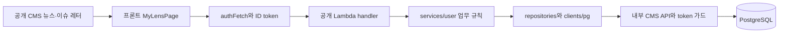
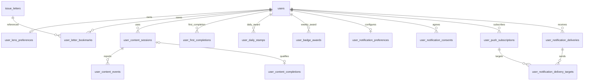

# 나의 LENS — 백엔드 데이터·구현 설계

기준일: 2026-10-14, HEAD `fc8c46e4` + 작업 트리. [인수인계](../product/나의LENS/백엔드_개발_인수인계.md) · [API 계약](나의LENS_백엔드_API계약.md) · [문서 지도](../README.md).

현재 코드로 확인한 구조와 신규 제안을 구분한다. 아래 새 파일·테이블은 아직 만들지 않았다. 운영 DB를 조회하거나 DDL을 실행하지 않았다. 예전 schema snapshot은 현재 운영 schema와 동일하다고 단정하지 않는다.

## 1. 기존 구조와 선택 이유

현재 개인 문장·프로필·읽기 기록의 공개 처리는 `service/backend` Lambda이고, 저장은 내부 HTTP로 `service/lens-cms-api`의 PostgreSQL repo에 위임한다. 이 경계를 재사용하는 것이 권장안이다. 새 ORM·추천 마이크로서비스·벡터 DB를 처음부터 추가할 필요는 없다.



이는 기존 개인 API 흐름이다. 새 dashboard/activity/notifications가 이 경로에 붙는 것은 제안이다. 실제 API Gateway/CloudFront integration은 현재 소스만으로 확인하지 않았으므로 구현 시 재조회한다.

재사용 근거:

| 책임 | 현재 파일·심볼 |
|---|---|
| 서버 JWT 검증 | [core/auth.py](../../service/backend/core/auth.py): verify_cognito_token/get_authenticated_user_id |
| 공개 문장·이력 | [archive handler](../../service/backend/handlers/user/archive.py), [user handler](../../service/backend/handlers/user/user.py) |
| 개인 업무 규칙 | [archive service](../../service/backend/services/user/archive.py), [profile service](../../service/backend/services/user/profile.py) |
| 내부 저장 호출 | [PersonalRepository](../../service/backend/repositories/personal_repository.py), [pg/personal.py](../../service/backend/clients/pg/personal.py) |
| 내부 인증·등록 | [routes_users](../../service/lens-cms-api/routes_users.py), [route_guards](../../service/lens-cms-api/route_guards.py), [main](../../service/lens-cms-api/main.py) |
| SQL·트랜잭션 | [personal_repo](../../service/lens-cms-api/personal_repo.py), [db.get_cursor](../../service/lens-cms-api/db.py) |
| 공개 콘텐츠 | [cms_posts_repo](../../service/lens-cms-api/cms_posts_repo.py), [issue_letters_repo](../../service/lens-cms-api/issue_letters_repo.py) |
| 기존 관심 점수 | [interests_repo](../../service/lens-cms-api/interests_repo.py): validate_interest_items/score_letter |
| 에디터 사전 | [editors_repo](../../service/lens-cms-api/editors_repo.py): letter_editors, issue_letter_editors |
| 기존 이메일 발송 | [letter_subscriptions_repo](../../service/lens-cms-api/letter_subscriptions_repo.py): 동의/확인/발송 원장. Web Push는 미구현 |

`service/backend/main.py`는 로컬 개발용 shim이다. 기존 backend CLAUDE/README에는 과거 DynamoDB·삭제된 모듈 이름이 남아 있어 현재 import 경로를 우선한다. `service/lens-cms-api/db.py`는 import 시 연결 풀을 만든다. 문서 검사나 단위 테스트에서 이 모듈을 그대로 import해 운영 DB에 접속하지 않도록 fixture DB/stub를 먼저 준비한다.

## 2. 신규 코드를 배치할 위치 — 제안

기존 구조를 유지하는 권장 배치다. 파일은 단계에 필요한 것부터 추가한다. 하나의 큰 `main.py`나 handler에 SQL·인증·추천·발송을 모두 넣지 않는다.

```text
service/backend/
  handlers/user/dashboard.py       # /api/v2/me dashboard·설정·저장·추천 라우팅
  handlers/user/activity.py        # session/event·기간·리워드 라우팅
  handlers/user/notifications.py   # 설정·동의·구독 라우팅
  services/user/dashboard.py       # 집계·공통 콘텐츠 shaping
  services/user/recommendations.py # 프로필·근거·후보 순위·예산
  services/user/activity.py        # 서버 유효 이용·완료 검증
  services/user/rewards.py         # 규칙 버전·배지 평가
  services/user/notifications.py   # 후보·일정·전송 가능성·전달 작업
  repositories/dashboard_repository.py # 응답 타입/저장 경계
  clients/pg/dashboard.py          # 기존 내부 HTTP/token 패턴
  models/dashboard.py             # 요청·반환 모델/enum/입력 검증

service/lens-cms-api/
  routes_dashboard.py             # /internal/dashboard, token 필수
  dashboard_repo.py               # 설정·팔로우·북마크·원본 일괄 조회
  activity_repo.py                # 세션·이벤트·완료·스탬프/배지 원자 저장
  notifications_repo.py           # 설정·동의·구독·발송 원장
```

위 새 파일은 **예정 파일**이며 근거 링크로 표시하지 않는다. 기존 `main.py`에 router 등록, `nginx.conf`에 내부 prefix forwarding, backend 배포 handler 등록/API Gateway integration이 필요하다. 기존 [lambda_handlers.txt](../../service/backend/lambda_handlers.txt)와 [deploy.sh](../../service/backend/deploy.sh)의 형식을 읽어 실제 신규 함수/route 필요 여부를 확정한다. 새 `v2/` 소스 폴더를 만들지 않는다.

handler: 요청·토큰·소유권·validation·HTTP 응답만. service: 점수·완료·배지·알림의 제품 규칙. CMS repo: 파라미터화 SQL·조건부 갱신·DB 트랜잭션. SQL 집계는 repo에서 수행해 원본 수천 행을 Lambda로 가져와 합산하지 않는다. 점수 규칙을 Lambda service와 CMS repo 두 곳에 독립 복제하지 않는다. 기존 `score_letter`는 순수 함수 재사용/이동 방향을 하나로 정하고 계약 테스트로 동일성을 확인한다.

신규 심볼의 권장 책임(아직 없는 함수이며 이름은 구현 시 기존 패턴에 맞춰 확정):

| 예정 모듈·함수 | 입력 → 출력·불변식 |
|---|---|
| dashboard service `get_dashboard` | 검증 owner, minutes → API-01 영역 응답. 개인 인증 실패를 부분 성공으로 낮추지 않음 |
| dashboard repo `resolve_content` | 명시적인 종류와 stable/legacy 키 → stable ID·현 slug·공개 상태·실제 metadata. 애매한 숫자/slug를 추정하지 않음 |
| dashboard repo `replace_preferences` | owner, expected revision, 검증된 관심/시간 → 새 revision. 한 transaction의 CAS 갱신 |
| dashboard repo `set_bookmark` | owner, stable letter ID, saved 상태 → 서버 저장 상태. toggle SQL 금지 |
| dashboard repo `import_browser_records` | owner, idempotency key/payload hash, 검토한 자료 → accepted/rejected·기존 재송신 결과. 해제 상태 부활 금지 |
| recommendations service `build_interest_profile` | owner의 유효 view·문장·선택·콘텐츠 metadata → 범위/표본 수가 있는 분야·용어 프로필 |
| recommendations service `rank_recommendations` | 공개 후보, profile, 이유 필터, 예산 → 실제 근거별 순위. private/삭제/중복/원문/기열람 제외 |
| activity service `evaluate_progress` | 서버 콘텐츠 길이·기존 세션·보고 metrics·서버 now·rule version → validated view/complete 판정. 부수효과 없는 함수로 테스트 |
| activity repo `commit_progress_and_awards` | 검증 owner/session, expected seq, event hash, 판정 결과 → event+view+completion+stamp+badge 원자적 결과. 충돌은 재계산 |
| rewards service `evaluate_weekly_badges` | 해당 KST 주의 완료·최초 완료·스탬프·재열람·저장 시각 → 증거가 있는 배지 후보. DB unique로 확정 |
| notifications service `plan_due_delivery` | 현재 owner 설정·동의·zone·공개 후보·now → 전송 없음 사유 또는 하루 1묶음 계획 |
| notifications repo `claim_delivery` / provider adapter `send` | DB lease·delivery/target ID → provider 결과. 미확정 timeout은 무조건 성공/재송신으로 처리하지 않음 |

위 표의 owner는 공개 요청에서 body 값을 받은 것이 아니라 인증 helper가 반환한 값이다. 내부 repo 호출에 user_id가 있는 것과 공개 API가 그 값을 신뢰하는 것은 구분한다. 모듈별 DTO는 API 문서의 공통 객체/enum으로 맞추고 서로 다른 success/error wrapper를 임의 복제하지 않는다.

## 3. 콘텐츠 정본과 resolver

| 종류 | 안정 키 | 주소·관계 |
|---|---|---|
| CMS 뉴스 | publication:publications.id | 공개 shape_lens의 id는 slug다. slug→publication ID로 resolve. 해당 publication의 renditions가 4포맷 |
| 모아쓰기 이슈 레터 | issue_letter:issue_letters.id | `/letter/{slug}`. CMS publication의 letter rendition과 별개 |
| 과거 기사 코드 | articles.article_no | 기존 원문용 별도 namespace. 자동 publication 번호로 해석 금지 |
| 문장 | user_archives.id | `article_no`라는 컬럼이 현재는 publications.slug를 가리키는 경로가 있음 |

resolver 입력은 kind와 안정 ID 또는 명시적인 legacy key 종류를 함께 받는다. 숫자로 보이는 slug를 publication ID로 우선 해석하지 않는다. `publication_slug_history`의 기존 구slug 조회와 공개 상태를 재사용한다. issue_letters의 slug 변경 이력은 현재 별도 계약이 확인되지 않아, 필요한 경우 ID 저장+현 slug 반환부터 적용한다.

새 관심 이벤트에 category/keyword/title을 클라이언트가 보낸 그대로 영구 정본으로 저장하지 않는다. 콘텐츠 metadata에서 category slug·등록 용어·실제 rendition/미디어 길이를 서버가 추출한다. 레터 토픽·뉴스 키워드는 동일 종류라고 가정하지 않고 type과 사전 키/표시명을 매핑한다.

문장 이전 자료의 연결 없는 행은 보존한다. 5000자 이하로 저장한 원문 snapshot을 편집자 수정으로 바꾸지 않는다. source가 삭제/비공개인 경우 사용자 저장 본문 유지 정책과 공개 메타데이터 노출 정책을 분리한다. 기존 FK가 ON DELETE CASCADE면 원문 hard delete가 문장까지 지울 수 있으므로 실제 제약을 확인한 뒤 보존 정책에 맞는 nullable stable FK/원문 snapshot으로 마이그레이션한다. 새 doc만으로 이미 보존되는 것으로 표현하지 않는다.

문장 source 확장 제안: 기존 user_archives에 nullable publication_id/issue_letter_id를 추가하고 기존 article_no는 호환 필드로 유지한다. article_no→publications.slug, rendition_id→renditions.publication_id로 검증 가능한 행만 backfill한다. 두 새 source FK는 둘 중 최대 하나만 채우고(옛 연결 불명 행 허용), 원문 삭제 시 SET NULL로 저장 문장은 보존한다. 기존 article_no CASCADE도 보존 정책과 일치하도록 변경한다. 모아쓰기 이슈 레터 slug를 현재 publications.slug FK에 그대로 넣지 않는다. 기존 POST payload는 유지하되 새 content_key가 있으면 명시적으로 resolve하고, 반환 article_id/href도 하위 호환·종류를 구분한다. 실제 이슈 레터 문장 저장 UI 연결은 현재 존재한다고 가정하지 않고 구현 범위를 확인한다.

## 4. 기존 저장소: 그대로 재사용하거나 보완

| 테이블 | 코드로 확인한 사용 | 변경/검증 요구 |
|---|---|---|
| users | id=Cognito sub, profile 및 badges | status·탈퇴 처리·PK/FK/최신 GRANT 확인. 이메일을 계정 정본으로 사용 안 함 |
| user_archives | id,user_id,content,sentence_hash,saved_at,article_no,rendition_id. unique(user_id,sentence_hash), 본인 DELETE 조건 | 개인 GET 인증, 서버 검색·cursor·source resolver. 같은 텍스트 여러 원문 저장은 현재 중복키로 합쳐짐; 임의 중복키 변경 금지 |
| user_readings | user_id,article_no 또는 publication_id,read_at,read_count. 콘텐츠별 최근 시각 갱신 | 완료 원장 아님. 기존 호환 이력은 보존하고 신설 event와 중복 관심 집계 금지 |
| reader_interests | 기기 hash/type/key/created_at | 기존 기기 API 보존. 계정 관심은 별도 owner 테이블 |
| issue_letters·topics·letter_editors | 발행 레터·주제·에디터 사전 | 실제 id/slug/type·active·공개 조건 재사용 |
| publications·renditions | CMS 콘텐츠·실제 제공 형식 | 뉴스/원문 resolver·duration·category/keyword 확보 |
| letter_subscriptions·letter_send_items 등 | 기존 이메일 확인·구독·발송 중복 제어 | 푸시 동의/구독과 혼합 금지 |

근거로 [원본 DDL](lens-erd-src/lens_schema_2026-08-26.sql), [개인화 전환](db-changelog/postgres/v1.24-개인화-전환.md), [문장 FK 수정](db-changelog/postgres/v1.34-user_archives-article_no-fk-수정.md), [기기 관심 DDL](lens-erd-src/lens_schema_v1.43_2026-10-09.sql)을 참고한다. 원본 DDL 이후 ALTER와 repo 요구가 있으므로 전체 원본 schema를 다시 실행하지 않는다. 현재 코드에 없는 view_events/추천 embedding 테이블의 설계만 보고 개인화가 구현됐다고 판단하지 않는다.

## 5. 신규 저장 모델 — 권장 초안

아래 사전은 **실제 DB에 이미 있는 제약이 아니다.** migration에서 구현하고 테스트할 요구다. 공통 규칙: 개인 테이블의 user_id는 VARCHAR(64), users(id) FK/ON DELETE CASCADE, 모든 서버 시각은 TIMESTAMPTZ. 순번 ID는 BIGSERIAL, UUID는 서버 또는 검증된 UUID. FK·타입·기존 sequence GRANT는 실제 DB에 대조한다. 초기 데이터가 작으면 단일 테이블을 사용하고 처음부터 파티션/외부 캐시를 추가하지 않는다.

### 5.1 계정 설정·저장

| 테이블 | 필드(타입·기본·NULL) | 키·제약·조회 인덱스 |
|---|---|---|
| user_lens_preferences | user_id; interests JSONB NOT NULL 기본 []; minutes SMALLINT 기본0; revision BIGINT 기본1; updated_at now() | PK user_id. minutes IN(0,5,10), JSON 배열 검증·최대40 및 사전 유효성은 서비스. JSON 전체 교체/revision atomic |
| user_editor_follows | user_id; editor_id BIGINT FK letter_editors(id); followed_at now() | PK(user_id,editor_id), 조회 user_id/followed_at. editor slug는 API resolver 사용 |
| user_letter_bookmarks | user_id; issue_letter_id BIGINT FK issue_letters(id); saved_at now(); version BIGINT 기본1 | PK(user_id,issue_letter_id), idx(user_id,saved_at DESC,issue_letter_id DESC). 삭제/비공개 row 해제 지원; soft-delete 콘텐츠와 참조 유지 정책 확정 |
| user_lens_imports | id UUID; user_id; idempotency_key VARCHAR128; payload_hash CHAR64; result JSONB; imported_at now() | PK id, UNIQUE(user_id,idempotency_key). 성공 결과는 이력; 알림 token/문장 본문 저장하지 않음. 오래된 import 재실행 방지 tombstone 보존 정책 필요 |

빈 행 기본값을 GET할 때마다 무조건 생성할 필요는 없다. 첫 변경 시 get-or-create하고 revision=0→1의 경쟁을 unique/upsert로 처리한다. current user/profile 동기화가 끝나기 전 신규 개인 저장에서 users FK가 실패하지 않도록 서버가 활성 user 존재를 보장한다.

관심을 query index로 대규모 발송 매칭해야 할 때만 별도 정규화 user_interests 테이블로 옮기는 확장을 검토한다. JSON과 정규화 배열을 동시에 서로 다른 정본으로 운영하지 않는다.

### 5.2 이용 세션·이벤트·완료

| 테이블 | 필드 | 제약·인덱스 |
|---|---|---|
| user_content_views | user_id; content_key VARCHAR96; last_seen_at TIMESTAMPTZ NULL; origin VARCHAR16(observed/legacy_import) | PK(user_id,content_key), idx(user_id,last_seen_at DESC). 계정별 약한 열람 정본. 시각 없는 import는 NULL, 신규 관찰 시 서버 시각으로 갱신. viewed와 completed를 분리 |
| user_content_sessions | id UUID; user_id; content_key VARCHAR96; format VARCHAR16; started_at; updated_at; ended_at NULL; last_seq INTEGER 기본0; visible_ms/active_ms BIGINT 기본0; progress JSONB 기본{}; rule_version VARCHAR32 | PK id, idx(user_id,started_at DESC), format CHECK, 누적 값>=0. content_key는 서버 resolve한 안정키. 형식/원문 소유권 세션 불변 |
| user_content_events | event_id UUID; user_id; session_id UUID FK sessions; session_seq INTEGER; payload_hash CHAR64; event_type VARCHAR16; client_occurred_at NULL; received_at; metrics JSONB; result JSONB | PK event_id, UNIQUE(session_id,session_seq), idx(user_id,received_at DESC). timestamp·metrics 범위/허용필드 검증. result는 재시도 응답. token·본문 없음 |
| user_content_completions | id UUID; user_id; session_id UUID NULL FK sessions ON DELETE SET NULL; content_key; format; reward_group_key VARCHAR128 NULL; completed_at; kst_day DATE; category_key VARCHAR64 NULL; rule_version | PK id, UNIQUE(session_id) WHERE session_id IS NOT NULL. idx(user_id,kst_day,content_key). 재열람 세션 완료도 보관. 그룹 NULL은 보상 판정 대기 |

content_key는 application resolver로 검증하는 논리 참조이며 DB에서 publications/issue_letters의 다형 FK로 가장하지 않는다. 삭제된 콘텐츠를 계속 정식 추천 후보로 반환하지 않지만 기존 완료 사실·시간과 최소 통계 근거는 남긴다. 콘텐츠 본문/제목 전체를 이벤트 JSON에 복제하지 않는다. snapshot이 필요한 category_key·rule_version은 개인정보와 보존 정책 범위 안에서만 저장한다.

세션/이벤트 raw 보존 90일을 초기안으로 제안한다. 세션 삭제 시 completion의 nullable session_id는 SET NULL로 하고 원장은 남긴다. 같은 완료의 재수락을 막는 event/import 식별값 보존 기간은 재시도 허용 기간과 함께 확정한다. event는 session 삭제 CASCADE로 정리 가능. 완료/배지는 별도 보존이며 탈퇴 시는 owner CASCADE.

### 5.3 스탬프·배지·동일 이슈 그룹

| 테이블 | 필드 | 제약·인덱스 |
|---|---|---|
| user_first_completions | user_id; reward_group_key; completion_id UUID FK completions; completed_at; kst_day; rule_version | PK(user_id,reward_group_key), 최초 유효 완료 불변. 새 그룹 최초 여부는 INSERT ON CONFLICT DO NOTHING 결과로 판정 |
| user_daily_stamps | user_id; kst_day DATE; completion_id UUID FK completions; awarded_at; rule_version | PK(user_id,kst_day), 하루1개. idx는 PK로 기간 조회 처리 |
| user_badge_awards | id UUID; user_id; badge_key VARCHAR32; period_key DATE(주 월요일); rule_version; awarded_at; evidence JSONB | PK id, UNIQUE(user_id,badge_key,period_key). 규칙버전 변경도 같은 주 동일 배지 중복 지급 안 함 |
| content_reward_groups | group_key VARCHAR128; status VARCHAR16; created_at; updated_at | PK group_key. status confirmed/pending. publication 한 개 4포맷은 기본 같은 group. cross-content mapping은 확인 후 |
| content_reward_group_members | group_key FK groups; publication_id BIGINT NULL FK publications; issue_letter_id BIGINT NULL FK issue_letters | num_nonnulls(...)=1. 각 content FK UNIQUE. 동일 이슈로 확인된 콘텐츠만 같은 그룹 연결 |

reward_group_key는 사용자/클라이언트가 선택하지 못한다. 아직 같은 이슈 여부를 확인 못한 항목은 pending이며 first_completion/stamp를 부여하지 않는다. 같은 publication의 모든 rendition은 보상 그룹을 공유한다. issue letter와 개별 원문이 일부 겹친다고 자동 같은 그룹으로 묶지 않는다. 매핑 변경 후 이미 지급한 원장을 조용히 재작성하지 않고 정정 정책·감사 근거를 남긴다.

DB 유일키로 이벤트 중복·같은 그룹·하루·주간 배지 중복을 각각 막는다. 서로 다른 새 콘텐츠를 같은 날 완료해도 completion은 여러 건, stamp는 한 건이다. 이미 완료한 저장 두 편 재열람은 badge 평가에만 쓰고 최초 완료·스탬프를 추가하지 않는다. 별도 완료 세션과 저장 시각을 비교한다.

### 5.4 푸시 설정·동의·전달

| 테이블 | 필드 | 제약·인덱스 |
|---|---|---|
| user_notification_preferences | user_id; preferences JSONB(현행 version1 필드); revision BIGINT; updated_at | PK user_id. 전체 유형 기본false, sentenceSource=false. time/zone/source 조건 앱 검증 |
| user_notification_consents | user_id; channel VARCHAR16; granted BOOLEAN 기본false; policy_version VARCHAR32; agreed_at NULL; revoked_at NULL; updated_at | PK(user_id,channel), channel=web_push 초기. granted일 때 서버 agreed_at 필요. 활성 설정과 분리 |
| user_push_subscriptions | id UUID; user_id; endpoint_hash CHAR64; subscription_encrypted BYTEA/TEXT; encryption_key_version VARCHAR32; active BOOLEAN; created_at; updated_at; revoked_at NULL | PK id, UNIQUE(endpoint_hash), idx(user_id,active). 암호화 실구현·키관리 필요. 평문 로그 금지 |
| user_notification_deliveries | id UUID; user_id; channel; schedule_date DATE; schedule_timezone VARCHAR64; status; payload JSONB; preferences_revision; consent_version; created_at; sent_at NULL; attempt_count INTEGER 기본0; lease_until NULL; last_error_code NULL | PK id, UNIQUE(user_id,channel,schedule_date). idx(status,lease_until). payload에는 콘텐츠key/유형만, 문장 원문 없음 |
| user_notification_delivery_targets | delivery_id UUID FK deliveries; subscription_id UUID FK subscriptions; status; provider_message_id NULL; sent_at NULL; attempt_count 기본0; last_error_code NULL | PK(delivery_id,subscription_id). 기기별 중복 제어·정리 정책 |

계정당 하루1묶음의 schedule_date는 발송 계획 시 선택한 zone의 일자다. 시간대 변경으로 같은 물리적 하루에 연속 알림이 생기는 것을 막기 위해 최근 전송 이후 24시간 제한을 추가하는 초기안을 제안한다. 이를 현행 제품 확정으로 표현하지 않고 운영 정책으로 검토한다.

provider_message_id나 endpoint는 화면에 노출하지 않는다. consent는 현재 상태뿐 아니라 동의/철회 감사 사건을 보존할 필요가 있으면 별도 최소 정보 audit를 추가한다. 실제 감사 보존 기간은 제품/운영 정책으로 확정한다. 사용자 탈퇴 시 암호화 구독·설정·대기 발송을 제거하고 외부 provider 해제 경로를 확인한다.

### 5.5 ERD 읽는 법

다음은 **제안 모델의 주요 관계**다. 기존 FK가 적용돼 있다는 그림이 아니다. group members의 실제 콘텐츠 FK와 원장 논리 참조는 위 표를 따른다.



## 6. 반드시 원자적으로 처리할 작업

### 설정과 가져오기

preferences row를 lock/CAS revision으로 확인 → 관심 검증 → 전체 교체 + revision 증가 → commit. 관심 사전 inactive 정책을 처리할 때 기존 본인 항목과 신규 추가를 구분한다.

import: 인증 owner/confirmed/payload hash 확인 → `(owner,key)` unique 또는 advisory/row lock으로 단일 실행 → 원본 slug를 resolve → 유효 북마크/팔로우/관심 합집합 → import 결과 저장 → 같은 transaction commit. 이미 완료한 키 재시도는 다시 저장하지 않는다. 부분 rejected는 결과로 반환, DB 실패는 전체 rollback. 내보내기/취소 기능을 설계하지 않은 상태에서 원본을 자동 삭제하지 않는다.

### 이벤트와 리워드

1. 세션 owner·제공 포맷·seq·서버 시간 검증. 누적 progress 범위 계산에 클라이언트 완료 플래그 사용 금지.
2. 유효 신호를 서버 rule_version으로 평가한다. 이전 seq보다 작은 늦은 진행은 기존 max 값 보존, 중복event는 저장 결과 재사용.
3. 단일 내부 HTTP operation/같은 cursor transaction에서 event + session progress를 저장하고 유효 열람이면 user_content_views를 갱신한다. legacy_import의 날짜 없음 상태를 임의의 과거 시각으로 보완하지 않는다.
4. 완료라면 session unique completion → 확인된 그룹 first_completion unique → 최초이면 daily_stamp unique → 주간 badge unique를 한 번에 반영한다. 이미 최초 완료한 경우 재열람 조건만 별도 평가한다.
5. rollback이면 event accepted/awarded 성공을 반환하지 않는다. 동일 payload 재시도는 최초 결과를 재반환한다.

product rule 계산을 공개 service에서 수행해도, internal operation은 세션 상태의 expected seq/revision을 확인하고 충돌이면 다시 계산하게 한다. 서로 다른 기기·콘텐츠가 한 주에 동시에 완료할 때 badge 평가 누락 방지를 위해 owner/week lock 또는 commit 후 재평가 작업을 사용한다. 독립 요청 세 번으로 completion/stamp/badge를 각각 commit하지 않는다.

## 7. 추천 구현과 자료 품질

현재 `main.py`의 lens 목록 shaper는 `shape_lens_summary`이며 `lenses[].keywords`를 제거한다. 상세 `shape_lens`의 등록 용어가 목록에도 있는 것으로 가정한 fixture만 사용하면 계약 누락을 놓친다. 프론트의 관찰 용어는 상세의 로컬 신호에서 오지만, 현재 목록 후보의 검색 텍스트는 제목·요약이다. 신규 계정 추천은 CMS repo에서 필요한 등록 용어만 경량으로 일괄 추출하거나 별도 metadata 계약으로 제공한다. 무거운 본문/컷/대본 전체를 목록에 복구하거나 100개 상세 N+1 조회를 추가하지 않는다. 서버 완료 조건은 제목에 없고 등록 용어에만 있는 관련 후보의 추천까지 포함한다.

초기판은 기존 [뉴스 순수 모델](../../service/frontend/src/widgets/MyLensPage/lib/news/newsModel.ts), [레터 모델](../../service/frontend/src/widgets/MyLensPage/lib/dashboardModel.ts)과 동등한 규칙 추천이다. 한국어 표기 NFKC·소문자·stopwords를 정규화하고 content ID 중복을 제거한다. substring 매칭은 의미 유사도나 품질 평가가 아니므로 이유 method=exact로 표시한다.

자동 관심: 최근 90일의 약한 유효 이용 콘텐츠를 서로 다른 content_key 단위로 집계. 동일 콘텐츠의 legacy user_readings와 새 event가 둘 다 있으면 한 건. 완료가 없는 글도 약한 관심 후보이며 완독률이라고 표현하지 않는다. 해당 콘텐츠가 최신 목록 밖이어도 stable ID로 서버 metadata를 일괄 조회한다.

문장: 본인 user_archives만 입력. 저장된 문장 분석 결과를 캐시할 때 owner·archive ID/updated state·algorithm_version을 포함한다. 삭제하면 연관 term·추천 캐시·대기 알림 후보를 무효화한다. 뜻이 같다는 설명은 embedding/semantic 구현 및 평가 이후만 허용한다.

후속: 초기엔 편집 확인된 relation을 입력받는 테이블/절차가 없으면 기능 unavailable로 둔다. 확장 제안 `content_relations(seed_content_key,related_content_key,relation_type,reason,verified_at,verified_by)`와 공개/품질 flag는 실제 editorial workflow·권한을 확정한 후 추가한다. LLM이 생성한 이유만으로 verified=true로 만들지 않는다. 문장별 단어 추천을 followup으로 전용하지 않는다.

followup seed 초기안은 본인 북마크 레터 및 서랍 문장의 확인된 원문이다. source가 NULL인 옛 문장이나 별도 명시적 팔로우가 없는 일반 열람 자료를 임의의 이슈 팔로우로 바꾸지 않는다. seed 삭제/해제는 알림 후보 재생성·전송 직전 검사에 반영한다. relation 필드 초기안: seed_content_key/related_content_key VARCHAR96, relation_type VARCHAR32(followup/background/different_perspective), reason TEXT, verified_at TIMESTAMPTZ, verified_by는 실제 편집자 식별자. UNIQUE(seed,related,type), seed/type/verified_at 인덱스. 이는 확인된 후속 기능을 켤 때 필요한 추가 모델이고 아직 구현된 테이블이 아니다.

캐시: 초기 개인 응답은 no-store. 서버 단기 캐시가 필요하면 owner·설정revision·기록/서랍갱신revision·알고리즘 버전으로 분리한다. 공개 목록 캐시는 재사용 가능하지만 기존 main.py 공유 `_list_cache`에 사용자 집계를 넣지 않는다. 본문/미디어 없이 필요한 card 필드만 batch query해 N+1 상세 요청을 없앤다.

## 8. 알림 작업의 책임과 실패 처리

기존 이메일 sender를 Web Push sender로 간주하지 않는다. 초기 Web Push provider/라이브러리·service worker·VAPID 관리와 브라우저 지원 범위는 구현 단계에서 확정한다. `uvicorn --workers 2` 환경의 각 worker에 in-memory timer를 두면 중복 발송되므로 상시 API process의 독립 background loop만으로 스케줄을 구현하지 않는다.

권장 흐름: 승인된 scheduler 1개 → DB 기반 due-plan/lease → 추천/품질·후속 관계 조회 → 날짜별 UNIQUE delivery → active 구독별 target → provider adapter → 상태 저장. scheduler 종류/신규 AWS 리소스는 운영 승인 범위에서 결정한다. 최초에는 dry-run으로 대상/이유만 확인하고 동의 없는 실사용자에게 시험 발송하지 않는다.

UTC now를 각 계정 IANA zone으로 변환해 due를 판정한다. threeDays는 그 zone의 월·수·금, weekly는 선택 요일. weekly 내용은 KST 기준 지난 월~일 기록으로 초기 일관성을 유지하고 응답에 집계 timezone을 명시한다. DST 중복 local time은 delivery unique로 한 번만, 시간이 없는 날은 허용 시간 안 다음 가능한 시각으로 처리하는 초기안을 검토한다. 늦은 작업이 21시 이후 도착하면 전송하지 않고 다음 허용 일정으로 연기/skip 상태를 남긴다.

전송 직전 types/paused/consent/owner/active/공개 상태/이미 읽음/중복을 재확인한다. provider 404/410은 구독 비활성화, 429/5xx는 제한된 backoff. timeout은 성공 여부 미확정이므로 무조건 재전송하지 않는다. provider가 idempotency를 지원하지 않으면 exactly-once 전달을 보장한다고 쓰지 않는다. 내부 delivery/target 중복 억제와 외부 실제 수신은 다른 보장이다. stale lease 재획득과 미확정 결과 처리 정책을 테스트한다.

## 9. 마이그레이션·환경·배포 준비

이 절은 절차 안내이며 실행 승인이나 배포 완료를 의미하지 않는다.

1. 현재 DB columns/constraints/FK/indexes/roles와 적용된 migration 버전을 읽기 전용으로 확인한다. v1.47 숫자만 보고 완전 schema snapshot이라고 생각하지 않는다.
2. 새 SQL은 기존 `docs/architecture/lens-erd-src/` 버전 규칙과 `db-changelog/postgres/` 설명을 따른다. 현재 최고 버전을 확인한 뒤 다음 버전을 배정한다. 사용자 자료 백업·DDL 적용 주체·락 영향·롤백을 작성한다.
3. `lens_service_app`의 SELECT/INSERT/UPDATE/DELETE·sequence USAGE/SELECT와 RETURNING 권한, batch 최소 권한을 함께 확인한다. 서비스 계정에 DDL 권한을 임의 부여하지 않는다.
4. 내부 API 코드를 먼저 배포하고 미연결 회귀 확인 → 공개 Lambda API/integration → 프론트 어댑터 순으로 진행한다. DB/schema가 없으면 개별 기능 unavailable로 제공하고 fake 데이터로 채우지 않는다.
5. 서비스별 전환/rollback 기준과 원장 보존을 명시한다. rollback이 새 원장·동의를 지우는 DDL drop을 의미하지 않는다. 기존 archive/이메일·로그인 계약을 그대로 회귀 확인한다.

현재 설정 이름(값은 문서에 복사하지 않음): backend `config/settings.py`의 Cognito 설정, pg client의 `LENS_CMS_API_URL`/`LENS_CMS_API_TOKEN`; CMS의 `ADMIN_INTERNAL_TOKEN`, `LENS_PG_HOST`, `LENS_PG_DATABASE`, `LENS_PG_USER`, `LENS_PG_PASSWORD`, `LENS_PG_POOL_MIN/MAX`, `LENS_PG_ACQUIRE_TIMEOUT`, `LENS_PG_STATEMENT_TIMEOUT_MS`. 신규 Web Push 비밀/공개키 설정명은 provider 선택 후 설정 정본에 추가한다.

기존 [nginx.conf](../../service/lens-cms-api/nginx.conf)·[ecosystem.config.js](../../service/lens-cms-api/ecosystem.config.js) 및 실제 edge 설정을 대조해 Authorization/Idempotency-Key forwarding, 개인 cache bypass, 내부 prefix 외부 공개 여부, HTTPS 경로를 확인한다. 공유 내부 토큰과 기존 평문 호출 주석이 있으므로 신규 내부 계정 데이터를 안전한 경로로 전달하는지 인수해야 한다.

AWS 리소스나 Bedrock 작업을 계획/실행하기 전 [비용태깅 규칙](비용태깅_규칙.md)을 전체 읽는다. 2026-10-01 이후 신규 작업은 Service=lens, 리소스 생성 전 태그, 생성 후 실제 재조회. Bedrock은 태깅된 application inference profile ARN만 쓰고 [모델 정본](../../pipelines/common/bedrock_models.py)을 확인한다. 초기 exact 추천에는 Bedrock 호출이 필요 없다.

## 10. 개발·검증 순서

| 검증 | 준비·기대 |
|---|---|
| 순수 단위 | scoring·정규화·예산·KST범위·완료·배지·schedule을 외부 호출 없이 검사. frontend의 기존 model 테스트를 서버 계약 fixture로 활용 |
| handler | JWT 검증 stub/로컬 서명 fixture로 없음·만료·타인·잘못된 입력·기존 호환 응답. 실 Cognito/JWKS 통신을 테스트 초기화에 요구하지 않음 |
| repo 통합 | 격리 PostgreSQL과 새 migration. 같은 saved_at cursor, owner 조건, FK/RETURNING, 동시 import/event/stamp/badge, transaction rollback |
| provider | fake sender·가짜 endpoint로 due/철회/410/429/timeout/중복 lease. 운영 메일·푸시 없음 |
| 프론트 연결 | 별도 A/B fixture 계정, 실제 API 계약 mock→격리 서버. 계정 전환·늦은 응답·401·공용 localStorage 분리·기존 서랍/레터/이메일 |
| 운영 인수 | 승인된 검증 계정·기기, 실제 API Gateway·DB권한·Cognito·푸시 수신. fixture 검증과 구분해 기록 |

현재 테스트 기반: backend `tests/test_user_service_streak.py`, `tests/test_core_response_contract.py`; CMS `tests/test_interests.py`, `tests/test_letter_subscriptions.py`. 이번 문서 작업에서는 이 테스트를 실행하지 않았다. 새 테스트 파일 이름은 구현 범위에서 정한다.

개발자가 실행할 예시(격리 환경/stub 준비 후, 이번 작업의 성공 명령 아님):

```bash
cd /Users/ldy/Desktop/Code/Sedaily/AILENS/service/backend
python3 -m pytest tests/test_user_service_streak.py tests/test_core_response_contract.py -q
```

```bash
cd /Users/ldy/Desktop/Code/Sedaily/AILENS/service/lens-cms-api
python3 -m pytest tests/test_interests.py tests/test_letter_subscriptions.py -q
```

환경에 pytest·추가 DB fixture가 준비됐는지 먼저 확인한다. repo 통합은 실제 운영 환경변수를 읽어 자동 실행하지 않는다. 새 API의 최소 테스트는 인수인계 7절 전체 시나리오다.

## 11. 근거·미확인 경계

확인: 프론트 라우트·로그인 gate·각 영역의 hooks/순수 모델/저장 키, 공개 Lambda 인증·라우팅, internal 라우터 등록, 개인 SQL·현재 관심 추천, schema/변경 기록·manifest/배포 설정 파일.

미확인: 최신 운영 DDL 적용 상태·실제 edge/integration·실제 JWT 로그인/권한·개인 자료 건수·전송 제공자·유효 완료 수치 확정·품질/후속 관계 운영. 저장소 문서만 보고 이 항목을 완료로 바꾸지 않는다.
