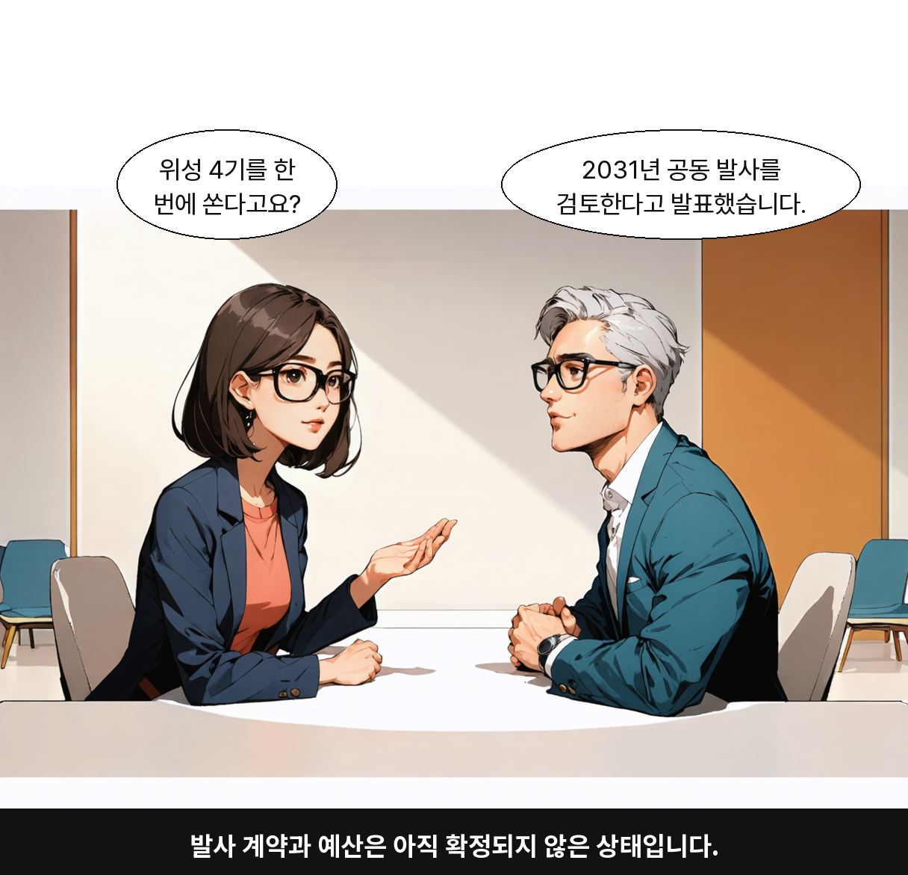
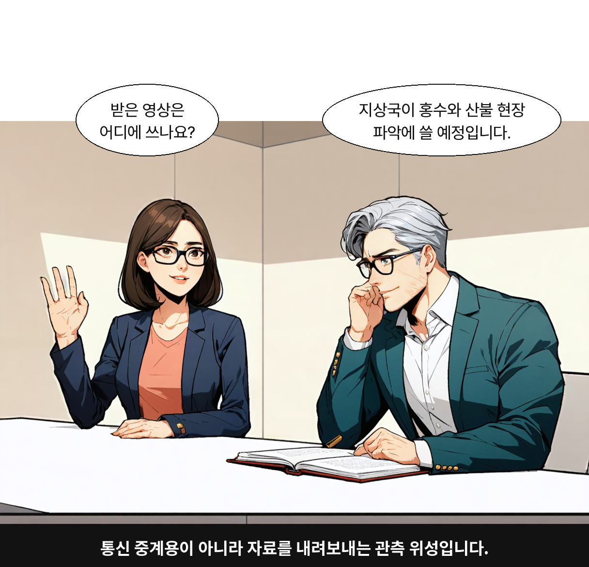
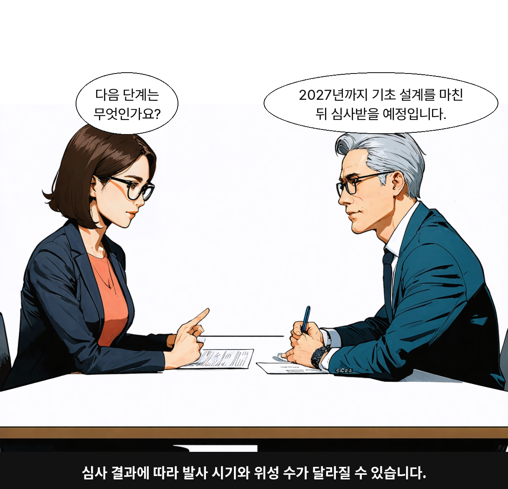

# 뉴스 웹툰 v63·이미지 v30 검증 자료

2026-10-23 프롬프트 개선에서 생성한 결과와 활성화 당시 조회 영수증이다. 이 자료를 PR로 정리하는 과정에서 추론·CMS 변경을 다시 실행하지 않았다. 모든 기사는 **합성 테스트 자료이며 실제 보도가 아니다**.

- [대본 v63 정본](../../../architecture/webtoon_custom/뉴스웹툰_기사별연출_운영프롬프트_2026-10-23.md)
- [이미지 v30 정본](../../../architecture/webtoon_custom/뉴스웹툰_기사별연출_이미지설정_2026-10-23.md)
- [개선 경위·기존 PR·실패 기록](../../../worklog/2026-10/2026-10-23-웹툰-기사별연출-프롬프트-개선.md)
- [파일 SHA256·크기 목록](manifest.json), [CMS 활성화 응답](activation-receipts.json), [활성화 후 본문 대조](verified.json)

## 시험 조건과 범위

대본은 실제 운영에서 읽은 조립 함수·모델 옵션·JSON 파서·검증 함수를 사용하는 로컬 실행으로 Bedrock에 요청했다. 이미지는 기존 공통 생성 함수와 한국어 합성 함수를 사용했다. CMS 로그인·웹소켓·저장·게시까지의 종단 시험은 아니다.

| 자료 | 당시 모델 | 대본 결과 | 대기 시간 | 프롬프트 버전 범위 |
| --- | --- | --- | --- | --- |
| [위성 계획 합성 기사](candidate-space-final.article.txt) / [8컷 대본](candidate-space-final.story.json) / [검사 기록](candidate-space-final.checks.json) | CMS 기본 Opus 5 | 8컷, 대화 6컷·정보 중심 2컷 | 62.728초 | 활성 v63과 SHA256 일치 |
| [도서관 합성 기사](candidate-scene-v3.article.txt) / [8컷 대본](candidate-scene-v3.story.json) / [검사 기록](candidate-scene-v3.checks.json) | Sonnet 5 | scene_led, 대화 없는 8컷 | 47.323초 | 수정 도중의 별도 후보, 최종 v63 전수 검증 아님 |
| [짧은 합성 기사](candidate-short-cms.article.txt) / [보류 응답](candidate-short-cms.story.json) / [검사 기록](candidate-short-cms.checks.json) | Sonnet 5 | needs_article, cuts=[] | 7.108초 | 수정 도중의 별도 후보, 최종 v63 전수 검증 아님 |

입력 토큰 8,694·출력 5,934는 최종 위성 대본 1회 실측이다. 전체 텍스트 시험은 실패·중간 후보를 포함해 13회이며 [사용량 기록](all-text-usage.json)에 각각 보존했다. 구조·인용 검사 통과를 사실 판단·정보 선택의 정확성이나 전체 이미지 품질 통과로 확대하지 않는다.

## 최종 이미지 3컷

이미지 모델은 Bedrock Stable Image Ultra(`image_sd_ultra`), 컷별 독립 생성, 참조 이미지 없음, seed 미지정이다. 원본은 1216×832이고 한국어 합성본은 1216×1171이다. 합성본의 세로 크기 증가는 말풍선·자막 배치 결과이며 원본 그림의 해상도 향상이 아니다. 얼굴 교체·수동 그림 보정·업스케일을 하지 않았다.

| 컷 | 생성 왕복 시간 | 원본 | 실제 요청 | 검사 기록 |
| --- | --- | --- | --- | --- |
| 1 | 12.749초 | [PNG](candidate-space-final-cut1-raw.png) | [JSON](candidate-space-final-cut1.image-request.json) | [JSON](candidate-space-final-cut1.image-checks.json) |
| 4 | 12.650초 | [PNG](candidate-space-final-cut4-raw.png) | [JSON](candidate-space-final-cut4.image-request.json) | [JSON](candidate-space-final-cut4.image-checks.json) |
| 8 | 13.402초 | [PNG](candidate-space-final-cut8-raw.png) | [JSON](candidate-space-final-cut8.image-request.json) | [JSON](candidate-space-final-cut8.image-checks.json) |

### 1컷 — 계획과 미확정 조건

### 4컷 — 관측 자료의 활용 계획

### 8컷 — 후속 심사와 변경 가능성

## 관찰과 남은 한계

- 여성의 갈색 단발·안경·남색/코럴 의상과 남성의 은회색 머리·안경·청록/아이보리 의상이 세 컷에서 구분된다. 공유 공간의 두 인물과 서로 다른 구도가 나왔다.
- 얼굴 윤곽과 나이감, 벽·책상 형태가 달라진다. 8컷에서는 배경이 크게 생략됐다. 동일 얼굴·공간을 보장하지 않는다.
- 4컷은 지문의 닫힌 노트 대신 펼친 책이 나오고 손동작도 다르다. 8컷 종이에는 글자처럼 보이는 무늬가 있다. 소품·동작·무문자 조건은 별도 검수가 필요하다.
- 1·4·8컷만 생성했으며 나머지 5컷과 scene_led 이미지의 품질은 검증하지 않았다. 200% 확대해도 원본에 없는 세부는 생기지 않는다.
- 앞선 고정 seed의 3회 시험에서는 서로 다른 프롬프트가 같은 분할 초상으로 나왔다. 추가 장면 우선 시험 1회도 안경 누락·로고로 제외했다. 최종 3컷까지 Ultra 총 7회이며, 성공한 3컷만으로 성공률·평균 비용을 추정하지 않는다.
- 최종 후보는 문장 길이·장면 순서·외형 설명·seed 조건을 함께 바꿨다. 이번 개선을 특정 한 요소의 단독 효과로 설명하지 않는다.

## 파일 보존과 검증

본문·JSON·PNG는 당시 산출물에서 복사했다. 인증 토큰, 자격 증명, 계정 ARN, 요청 인증 헤더와 운영 전체 덤프는 포함하지 않는다. manifest는 복사한 27개 원자료의 바이트 크기와 SHA256을 기록한다. 공개 소비 API 일치·편집 초안 동기화는 활성화 직후의 저장된 검증 결과이며 항상 최신 상태라는 뜻은 아니다.

PR 준비 시 파일 해시·PNG 읽기/크기·원문 인용·컷 메타데이터 계약·추가한 Markdown 로컬 링크를 다시 검사해 통과했다([보존 검증 결과](record-verification.json)). 새 유료 추론과 코드 배포는 이 문서 PR의 검증에 필요하지 않다.
