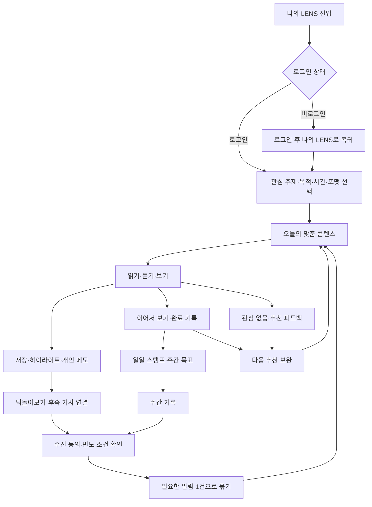

# AI LENS 개인화 대시보드 통합 기획안 v0.1

작성일: 2026-10-14 · 상태: 검토용 제안 · 범위: 기능 및 운영 정책 기획

> 후속 실행: 사용자가 같은 날 프론트엔드 구현을 명시적으로 요청했다. 15절의 별도 ‘나의 LENS’ 방향으로 `/my-lens`를 구현했다. 이 문서의 이전 ‘구현 제외’ 문구는 기획 당시 범위이며, 현재 프론트엔드 결과는 [프론트 작업 기록](2026-10-14-나의LENS-프론트엔드-구현.md), 서버 미구현 범위는 [백엔드 요청](../../product/나의LENS/백엔드_연동요구사항.md)을 따른다.

> 접근 정책 활성화(2026-10-14): **‘나의 LENS’는 개발 화면에서도 로그인한 사용자만 접근한다.** 사용자의 명시적인 전환 요청에 따라 프론트엔드 비로그인 접근 예외를 종료했다. 직접 URL·내부 탭·딥링크에서도 인증 확인 전에는 개인 화면을 표시하지 않고, 비로그인은 로그인 화면으로 이동한다. 기존 로그인 복귀 기능으로 탭·검색 파라미터·해시를 복원한다. 아래 후속 구현 기록의 ‘개발 중 비로그인 유지’는 이번 전환 이전 상태이며 이 정책을 우선한다. 서버 인증·계정 동기화 인수와 운영 배포는 별도다.

> 후속 검토: 사용자는 ‘로그인 메뉴의 내 서랍’을 구성 방식의 참고로 지정했다. **내 서랍을 교체하거나 개편하지 않고, 유사한 콘텐츠 중심 구성의 별도 개인화 화면을 제안한다.** 기존 저장 경험과 새 화면의 역할·연결은 §15를 우선 기준으로 읽는다. 아래 상세 정책은 검토용 후보이며 출시 범위를 확정한 것이 아니다.

사용자 요청: 앞서 검토한 행동·관심사 분석, 맞춤 대시보드, 콘텐츠 추천, 리워드, 개인화 알림을 롱블랙·Headway·Readwise 참고 방향과 통합한다. 실제 개발·구현은 제외한다.

위에서 확정한 접근 정책을 제외한 화면명, 수치, 지급·발송 조건은 제안이다. 현재 제공 중인 기능이나 확정된 사업 정책을 뜻하지 않는다. 코드, 데이터베이스, API, 인프라, 배포 설계 및 개발 일정은 포함하지 않는다.

## 1. 목표와 대상

### 서비스 개념

**나의 LENS: 오늘 필요한 뉴스를 내 시간과 방식에 맞게 보고, 기록을 쌓으며 관심 이슈의 다음 소식까지 이어가는 개인 대시보드.**

사용자에게 제공할 가치는 세 가지다.

1. 발견: 무엇을 볼지 고르는 시간을 줄인다.
2. 이해와 기록: 목적에 맞는 포맷을 선택하고 필요한 내용을 저장한다.
3. 지속: 기록·후속 소식·주간 목표를 통해 다시 방문할 이유를 만든다.

초기 우선 대상은 출퇴근·업무 전후 짧은 시간에 경제·산업 뉴스를 확인하려는 성인 독자로 가정한다. 경제 입문자와 시사 관심 독자도 이용 목적 선택으로 수용한다. 연령·직업을 필수로 수집하거나 행동으로 신분을 추정하지 않는다.

| 이용 목적 | 독자의 질문 | 제안할 콘텐츠 경험 |
|---|---|---|
| 업무 동향 파악 | 내 분야에 무슨 변화가 있나? | 관심 산업·기업의 최신 소식, 배경과 영향 설명 |
| 경제 기초 이해 | 이 뉴스가 왜 중요한가? | 쉬운 해설, 용어·배경 콘텐츠, 관련 과거 사건 |
| 시사 흐름 따라가기 | 오늘 알아둘 일이 무엇인가? | 주요 이슈와 짧은 콘텐츠, 다른 분야 발견 |

이용 목적은 독자의 능력 등급이 아니며 언제든 바꿀 수 있다. 투자 성과나 개인의 경제 이해도 향상을 보장하는 표현은 사용하지 않는다.

### 방향 비교

| 접근 | 장점 | 한계 | 판단 |
|---|---|---|---|
| 매일 5분 개인 뉴스 루틴 | 추천·기록·참여·재방문이 한 흐름으로 연결됨 | 추천 묶음과 후속 연결 품질 관리 필요 | 추천 방향 |
| 관심 키워드 뉴스 보드 | 적은 행동 데이터로도 설명 가능한 추천 | 개인 기록과 습관 형성 가치가 약함 | 가장 단순한 초기 검토안 |
| 개인 지식 대시보드 | 저장·복습·과거/현재 연결로 누적 가치 확보 | 이력 축적, 연관 콘텐츠 검수, 운영 기준 필요 | 장기 확장 방향 |

추천 방향으로 전체 경험을 설계하고, 개인 지식 대시보드까지 단계적으로 검토한다. ‘5분’은 기본 선택값이며 시간 선택은 3·5·10분으로 제안한다.

## 2. 이전 기획과 참고 서비스의 통합

| 기존 검토 항목 | 이번 통합안 | 주된 참고 요소 |
|---|---|---|
| 행동·관심사 분석 | 직접 선택한 관심 주제 + 이용 목적 + 가용 시간 + 이용 행동 | Headway의 목표·이력 기반 추천 |
| 개인 대시보드 | 오늘의 콘텐츠, 이어서 보기, 관심 이슈 변화, 뉴스 노트, 주간 기록 | 세 서비스의 오늘 할 일·개인 기록 경험 |
| 관심 콘텐츠 추천 | 주제·목적·포맷·시간에 맞는 묶음과 추천 이유·피드백 | Headway |
| 리워드 | 하루 이용 스탬프, 주간 목표 배지, 선택형 탐색·복습 미션 | 롱블랙의 읽기 습관과 보상 연결 |
| 개인화 푸시 | 선택한 시간의 브리핑, 저장·팔로우 이슈의 후속 소식, 주간 기록 | Readwise의 재방문 맥락을 뉴스에 맞게 변형한 제안 |
| 초기 Lesser School·DIG 참고 | 소비 현황 피드백, 선택형 뉴스 퀴즈와 해설 유지 | 분석·피드백 및 읽기·참여 연결 |

| 서비스 | 공식 공개 자료에서 확인한 내용 | AI LENS에 적용하는 범위 |
|---|---|---|
| 롱블랙 | 오늘의 노트, 읽기 스탬프·샷 교환, 셀렉션 제휴 혜택 | 오늘 볼 콘텐츠와 주간 누적 성취. 열람 기한 제한과 유료 제휴 보상은 초기 범위에서 제외 |
| Headway | 온보딩 목표와 읽기·듣기 이력에 따른 추천, 하이라이트, 복습과 연속 이용 | 이용 목적·포맷·시간에 맞는 추천. 이용자 능력 등급이나 경쟁 순위는 도입하지 않음 |
| Readwise | 저장한 하이라이트의 Daily Review, 재등장 빈도 조절 | 저장 내용 되돌아보기와 관련 최신 소식 연결. 후속 기사 연결은 AI LENS 자체 제안 |

공개 안내 확인에 한정하며 로그인 이후 화면과 실제 추천·지급 효과는 검증하지 않았다. 1차 자료는 문서 마지막에 기재한다.

## 3. AI LENS 기존 경험과의 관계

기존 기획 문서에는 레터·웹툰·팟캐스트·영상, 최신 뉴스, 카테고리, 지난 지면, ‘그날로 떠나요’가 정의돼 있다. 2026-10-04 정책 기록에는 홈의 포맷별 미리보기를 최신순으로 제공하고 별도 포맷 목록을 폐기한 결정이 있다. 이는 문서 시점의 근거이며 현재 운영 동작은 이번 작업에서 확인하지 않았다.

- 개인화 진입점으로 **‘나의 LENS’**를 제안한다. 공용 홈·최신 뉴스와 역할을 구분하며 기존 최신순 영역을 자동으로 개인화 순서로 바꾸지 않는다.
- 개인 대시보드의 콘텐츠를 누르면 해당 레터·웹툰·오디오·영상 상세로 연결한다. 별도 포맷 목록을 다시 만드는 방향은 포함하지 않는다.
- 동일 이슈의 여러 포맷은 한 카드에서 ‘읽기/듣기/보기’ 선택지로 연결한다. 서로 다른 뉴스처럼 중복 추천하지 않는다.
- ‘그날로 떠나요’는 현재 이슈를 이해하는 데 도움이 되는 검증된 과거 사건이 있을 때 배경 콘텐츠로 연결한다. 지난 지면과 과거 사건 탐색은 구분한다.
- 기존에 발행·검수된 콘텐츠 중 적합한 것을 우선 추천한다. 개인마다 신규 콘텐츠를 생성한다는 전제는 두지 않는다.
- 후속 정적 조사에서 회원 인증 UI, ‘내 서랍’ 문장 저장·조회·삭제 API 호출, 저장 문장 키워드 기반 기사 추천, 레터의 브라우저 저장·읽음·팔로우 로직을 확인했다. 현재 운영 계정에서의 동작, 전체 포맷의 진행률·계측·푸시 채널은 검증하지 않았다. 기존 기능과 신규 요구를 구분하며 §15의 연결 방안을 따른다.

## 4. 대시보드 구성

### 화면의 정보 순서

모바일에서는 아래 순서로 배치하고, 데스크톱에서는 콘텐츠 영역 옆에 주간 목표·설정을 보조 배치하는 구상이다. 위젯 편집과 자유로운 드래그 재배치는 초기 기획에 포함하지 않는다.

| 순서 | 영역 | 보여줄 내용 | 주요 행동 | 노출 조건 |
|---|---|---|---|---|
| 1 | 오늘의 설정 | 이용 목적, 3·5·10분, 선호 포맷 | 오늘만 변경, 기본 설정 변경 | 항상 |
| 2 | 오늘 나를 위한 뉴스 | 가장 중요한 추천부터 1~3건, 예상 소요 시간, 발행일, 추천 이유 | 시작하기, 다른 포맷, 이 추천 바꾸기 | 항상, 부족하면 편집 추천 |
| 3 | 이어서 보기 | 진행 중 1건과 저장한 콘텐츠 최대 2건 | 이어보기, 나중에 보기 | 해당 기록이 있을 때 |
| 4 | 관심 이슈의 다음 소식 | 팔로우·저장 이슈와 연결된 새로운 사실 또는 변화 | 후속 기사 보기, 이전 기사와 함께 보기 | 확인된 새 소식이 있을 때 |
| 5 | 나의 뉴스 노트 | 저장 기사, 하이라이트, 개인 메모, 다시 볼 기록 | 저장 목록 열기, 메모 수정, 삭제 | 개인 기록이 있을 때 |
| 6 | 이번 주 기록 | 이용 일수, 주제·포맷 분포, 목표·배지, 선택 퀴즈 | 주간 기록 보기, 해설 보기 | 이용 이력이 있을 때 |
| 보조 | 새로운 발견·주요 뉴스 | 관심 분야 밖의 연결 주제와 공통 주요 뉴스 | 더 둘러보기 | 오늘의 묶음과 별도 구분 |

개인화 설정·관심 주제 관리·알림 설정은 한 설정 진입점에서 찾을 수 있게 한다. 카드마다 서로 다른 설정 화면으로 흩어놓지 않는다.

### 오늘의 묶음 규칙

- 3분은 짧은 콘텐츠 1개, 5분은 1~2개, 10분은 2~3개를 기본 예시로 삼되 실제 예상 소요 시간에 맞춰 조정한다.
- 선택 시간을 넘기며 개수를 채우지 않는다. 긴 콘텐츠는 실제 예상 시간을 표시하고 시간 변경이나 더 짧은 콘텐츠 선택을 안내한다.
- 기본적으로 관심 뉴스 1개를 우선하고, 여유가 있으면 다른 관심 이슈 또는 관련 탐색 콘텐츠를 추가한다. 편집상 주요 뉴스는 별도로 발견할 수 있게 한다.
- 예상 시간은 이해도를 뜻하지 않으며 텍스트·웹툰은 추정치, 음성·영상은 재생 시간을 바탕으로 안내한다.
- 완료한 항목을 갑자기 새 기사로 교체해 진행률이 초기화되지 않게 한다. 같은 날에는 완료 기록을 유지하고 업데이트를 별도 표시한다.
- 정정·삭제된 콘텐츠는 추천에서 제외하고, 이미 저장한 경우 상태와 정정 내용을 안내한다.

### 첫 화면 예시 — 가상 콘텐츠

> 나의 LENS · 업무 동향 파악 · 오늘 5분 · 읽기 우선\
> **오늘 알아둘 산업 뉴스**\
> 반도체 수요 변화, 핵심만 보기 · 레터 · 약 3분\
> 추천 이유: 선택한 관심 주제 ‘반도체’\
> 관련 전력 인프라 이슈 · 웹툰 · 약 2분\
> 추천 이유: 반도체 산업과 연결된 주제\
> [오늘의 뉴스 시작] [시간·포맷 변경]\
> **이어서 보기**: 어제 저장한 공급망 해설\
> **관심 이슈의 다음 소식**: 저장한 이슈의 후속 기사\
> **이번 주**: 목표 3일 중 2일 이용

예시 두 콘텐츠의 시간은 화면 설명용이다. 실제 콘텐츠 분량이나 보유 수량을 가정한 것이 아니다. 이어서 보기와 후속 기사는 5분 묶음 외의 선택 콘텐츠임을 구분한다.

## 5. 사용자 이용 흐름

### A. 첫 방문과 첫 개인화

정식 서비스에서는 `/my-lens` 직접 URL, 메뉴, 북마크, 알림 링크 등 진입 방식과 관계없이 로그인 상태를 확인한다. 비로그인 사용자는 로그인 화면으로 이동하고, 로그인에 성공하면 ‘나의 LENS’로 돌아온다. 세션이 만료되거나 로그아웃하면 개인 대시보드 접근과 개인 데이터 표시를 중단하고 다시 로그인을 안내한다.

화면 확인을 위해 허용했던 개발 중 비로그인 접근 예외는 2026-10-14 사용자 전환 요청으로 종료했다. 공개 홈·콘텐츠 정책과 기존 인증 API 권한은 변경하지 않는다.

1. 공용 홈이나 기사에서 ‘나의 LENS’를 발견한다. 정식 서비스에서는 로그인 후 진입한다. 공용 홈·공개 기사 열람에는 이 대시보드 접근 정책을 확대 적용하지 않는다.
2. 관심 주제 1~3개와 주된 이용 목적 1개를 선택한다. 모두 건너뛰면 공통 주요 뉴스와 편집 추천을 제공한다.
3. 기본 이용 시간 5분을 제안하고, 읽기·듣기·보기 또는 ‘상관없음’을 고르게 한다. 오늘만 변경하는 설정과 기본값을 바꾸는 설정을 구분한다.
4. 곧바로 오늘의 묶음과 추천 이유를 확인한다. 선호도 설문을 길게 진행하지 않는다.
5. 첫 콘텐츠를 소비하고 저장·관심 없음·다음에도 보기 중 필요한 행동을 선택한다.
6. 기록의 보관 범위를 안내한다. 대시보드 로그인 필수와 계정 간 기록 동기화는 별개다. 계정 동기화가 준비되기 전에는 로그인했더라도 브라우저·기기 기록이 여러 기기에 자동 저장된다고 약속하지 않는다. 개발 중 비로그인 예외에서 만든 기록도 같은 원칙을 따른다.
7. 첫 완료 또는 관심 이슈 팔로우 후 알림의 구체적인 편익과 빈도를 안내한다. 사용자가 알림 받기를 선택한 뒤 지원 채널의 권한을 요청하는 구상이다.

### B. 일상 이용

1. 직접 방문하거나 동의한 알림에서 들어와 로그인 상태를 확인한 뒤 이용한다. 개발 화면에도 같은 로그인 필수 정책을 적용한다.
2. 오늘의 시간·포맷이 맞는지 확인하고 바로 소비한다.
3. 필요하면 같은 이슈의 다른 포맷으로 전환한다. 중복 노출·보상은 발생하지 않는다.
4. 완료 조건에 도달하면 일일 스탬프를 자동 반영한다. 확인창이나 퀴즈를 통과해야 다음 기사를 볼 수 있는 구조로 만들지 않는다.
5. 선택적으로 한 줄 메모·하이라이트를 남기거나 관련 퀴즈 한 문항을 푼다.
6. 오늘의 묶음을 끝내면 ‘오늘 준비한 뉴스를 모두 봤어요’를 표시하고 자유 탐색은 별도로 제공한다.

### C. 저장한 이슈의 재방문

1. 사용자가 기사 A를 저장한다. 저장 자체가 푸시 수신 동의를 뜻하지 않는다.
2. 기사 A와 관련된 중요한 새로운 사실이 담긴 기사 B가 발행된다.
3. 대시보드에서 ‘저장한 이슈의 다음 소식’으로 A와 B를 연결한다.
4. 사용자가 후속 알림에 동의했다면 다음 허용 시간의 묶음 알림에 포함한다.
5. 기사 B를 소비한 후 변경된 내용을 개인 메모로 남길 수 있다.

### D. 주간 회고와 장기 미이용

- 주간 기록은 월요일 00:00~일요일 24:00 한국 시간을 기준으로 제안한다. 지난주 기록은 다음 월요일에 제공한다.
- 이용한 날짜, 관심 주제, 저장·복습 기록을 보여주고 주간 목표 달성 시 배지를 표시한다.
- 신규 콘텐츠 완료가 3건 미만이면 주제 비율을 단정적으로 해석하지 않고 실제 기록 위주로 보여준다.
- 며칠 쉬어도 기존 스탬프·배지는 보존한다. 복귀 시 중단한 콘텐츠와 놓친 주요 변화를 간단히 제안한다.
- 장기 미이용자를 반복적인 미션 독촉이나 보상 소멸 안내로 불러오지 않는다.

## 6. 행동 분석과 추천 정책

### 분석할 정보와 해석

| 정보 | 추천 활용 | 해석상 제한 |
|---|---|---|
| 직접 선택한 주제·팔로우·차단 | 가장 명확한 선호로 사용 | 차단은 자동 추정보다 우선. 일시 행동으로 설정을 덮어쓰지 않음 |
| 이용 목적·가용 시간·선호 포맷 | 오늘 볼 콘텐츠의 표현·분량·순서 조정 | 직업·능력·신념으로 변환하지 않음 |
| 노출·열람 | 추천을 봤는지와 선택했는지 구분 | 많이 노출돼 많이 눌린 현상을 선호로 단정하지 않음 |
| 실제 소비·이어보기·반복 이용 | 지속적인 관심과 포맷 선호의 보조 신호 | 백그라운드 방치·자동 재생·빠른 넘기기·오류로 인한 이탈을 구분해야 함 |
| 저장·주제 팔로우 | 다시 확인할 가치가 있는 관심으로 활용 | 보상 때문에 한 행동인지 별도 관찰 |
| 관심 없음·너무 길어요·이미 알아요 | 주제·시간·기시청 상태를 각각 조정 | ‘너무 길어요’를 해당 주제 차단으로 해석하지 않음 |
| 퀴즈·배지·스탬프 | 참여·습관 피드백에 사용 | 정답률·점수를 전체 지식 수준이나 추천 우선권으로 사용하지 않음 |

최근 반복 행동을 오래된 행동보다 더 반영하되, 단일 방문으로 성향을 고정하지 않는다. 초기 제안은 최근 30일을 관심 변화의 관찰 창으로 삼는다. 이 값은 데이터 보유 기간과 별개이며 실제 이용 빈도를 보고 조정한다.

개인 메모 내용은 초기 추천 분석 대상에서 제외한다. 관심 설정과 명시적인 저장·이용 신호만으로 먼저 가치를 검토한다.

### 추천 순서

1. 발행·검수 완료, 열람 가능, 최신 상태 확인 등 기본 제공 조건을 충족하는 콘텐츠를 고른다.
2. 사용자가 차단한 주제와 이미 완료한 동일 콘텐츠를 기본 추천에서 제외한다. 다시 보기는 별도 영역으로 제공한다.
3. 직접 선택한 관심사·목적을 우선하고 반복 소비·저장을 보조 신호로 반영한다.
4. 선호 포맷의 실제 제공 여부와 선택한 시간을 맞춘다. 해당 포맷이 없으면 다른 형식을 명시해 제안한다.
5. 동일 이슈의 중복 기사를 줄이고, 새 사실이 있는 후속 기사는 연결 관계를 설명한다.
6. 관련 탐색 콘텐츠와 주요 뉴스를 볼 경로를 확보한다. 관심 밖 콘텐츠를 사용자가 차단한 주제를 우회하는 수단으로 쓰지 않는다.
7. ‘선택한 주제’, ‘저장한 기사와 관련’, ‘이어 보던 콘텐츠’ 등 실제 근거로 추천 이유를 붙인다.

### 콜드 스타트·실패 상황

- 선택값도 이력도 없음: 편집 추천과 공통 주요 뉴스로 시작한다.
- 추천 후보 부족: 건수를 줄이고 최신 발행일을 명시한다. 빈 칸을 채우기 위해 같은 이슈를 여러 포맷으로 반복하지 않는다.
- 추천이 마음에 들지 않음: 다른 추천으로 교체하고 이유를 선택적으로 남긴다. 피드백은 필수가 아니다.
- 개인화 해제: 공통 추천으로 전환하고 개인화 행동 수집도 중지한다. 사용자가 요청한 저장·이어보기·보상 기능에 필요한 기록과는 목적을 구분해 안내한다.
- 관심 기록 초기화: 추천용 이력을 초기화하며 저장 기사·획득 배지는 별도 선택 없이 지우지 않는다. 기록 종류별 삭제 범위를 분명하게 보여준다.
- 저장 자료가 삭제·정정됨: 최신 상태와 대체 자료가 있으면 안내하고, 없는 내용은 복습 대상으로 내보내지 않는다.

## 7. 나의 뉴스 노트와 되돌아보기

개인 기록은 저장 기사, 선택한 문장, 개인 메모로 구성한다. 콘텐츠 출처·발행일·저장일·연결 포맷을 함께 제공한다.

- 저장함은 ‘나중에 보기’와 ‘다시 보기’를 구분한다. 미완료 콘텐츠를 복습했다고 표시하지 않는다.
- 이미 읽은 저장 내용은 사용자가 선택한 빈도로 대시보드에서 다시 제안한다. 초기값은 주 1회이며 다시 보고 싶지 않은 항목은 제외할 수 있다.
- 새로운 후속 보도가 있으면 과거 기사와 함께 보여준다. 같은 키워드가 등장했다는 이유만으로 후속 기사라고 부르지 않는다.
- 후속 연결에는 ‘새 발표’, ‘수치 갱신’, ‘결과 공개’, ‘정정’처럼 변화의 근거가 있어야 한다. 근거가 없으면 ‘관련 기사’로만 표기한다.
- 경제 용어나 과거 사건은 ‘그날로 떠나요’와 연결할 수 있다. 과거 사실이 현재도 유효한 설명인지 확인한다.
- 초기에는 개인 메모를 비공개로 유지한다. 공개 댓글·친구 경쟁·공유 피드는 별도 기획으로 남긴다.

## 8. 리워드 정책

### 초기 보상 구성

| 보상 | 제안 조건 | 사용자에게 보이는 결과 |
|---|---|---|
| 일일 스탬프 | 그날 처음으로 신규 콘텐츠 1건을 완료. 하루 최대 1개 | 주간 달력에 이용 기록 |
| 주간 루틴 배지 | 한 주에 서로 다른 3일의 스탬프 획득 | 해당 주의 달성 배지 |
| 새로운 발견 배지 | 한 주에 서로 다른 3개 대주제의 신규 콘텐츠 완료 | 탐색 기록, 전문성 등급으로 표현하지 않음 |
| 되돌아보기 배지 | 한 주에 저장해 두고 이미 읽은 서로 다른 콘텐츠 2건을 다시 확인 완료 | 복습 기록. 일일 스탬프와 별도 |

‘신규’는 해당 계정에서 아직 완료하지 않은 콘텐츠를 뜻한다. 동일 이슈의 포맷 전환은 추가 완료·신규 보상으로 계산하지 않는다. 새 사실을 담은 별도의 후속 기사는 신규 콘텐츠로 다룰 수 있다. 같은 날 여러 미션을 달성해도 현금성 포인트가 누적되는 구조는 아니다.

### 완료 판단 — 검증 전 가설

- 레터·웹툰: 내용의 80% 이상을 확인하고, 전면에서 이용한 시간이 예상 소요 시간의 30% 이상인 경우를 초기 관찰 기준으로 제안한다.
- 팟캐스트·영상: 중복·건너뛰기를 제외한 콘텐츠 구간의 80% 이상을 재생한 경우를 제안한다. 오디오의 정상적인 백그라운드 청취는 인정한다.
- 이 기준은 실제 독해·이해를 증명하지 않는다. 배속·빠른 읽기·보조기기 이용자의 실제 경험을 관찰한 뒤 확정한다.
- 진행 상태를 측정하기 어려운 접근성 환경에는 ‘다 봤어요’ 수동 기록을 제공하는 방향을 검토한다. 동일한 비금전 배지는 제공하되 성과 분석에서는 수동 기록과 자동 추정을 구분한다.
- 재시도·화면 새로고침·기기 이동으로 같은 보상이 중복 지급되지 않아야 한다.

### 퀴즈의 역할

읽은 콘텐츠의 핵심 사실에 대한 선택형 한 문항과 해설·근거 링크를 제안한다. 정답을 맞혀야 스탬프를 받거나 다른 기사를 볼 수 있는 조건은 두지 않는다. 오답에는 관련 해설을 제시하고, 동일 문항 재시도로 보상을 반복 지급하지 않는다. 검수할 문항이 없는 콘텐츠에는 퀴즈를 붙이지 않는다.

### 후속 검토

초기 보상은 비금전 스탬프·배지에 한정한다. 포인트, 콘텐츠 이용권, 행사·제휴 혜택은 예산·혜택 공급·지급 및 회수·만료·부정 이용 정책을 정한 후 별도 검토한다. 연속 출석 실패에 대한 기록 몰수, 공개 순위, 기사 클릭만으로 지급하는 보상은 제안하지 않는다.

## 9. 개인화 알림 정책

### 알림 유형과 목적지

| 유형 | 발송 후보 조건 | 문구 예시 | 도착 화면 |
|---|---|---|---|
| 오늘의 브리핑 | 선택한 요일·시간에 새 추천이 있고 해당 묶음 미완료 | ‘오늘의 산업 뉴스, 약 5분으로 확인하세요’ | 오늘의 묶음 |
| 관심 이슈 후속 | 동의한 팔로우·저장 이슈에 의미 있는 새 사실 | ‘저장한 공급망 이슈에 새 발표가 있어요’ | 이전·후속 기사 연결 화면 |
| 주간 기록 | 기록이 있고 주간 알림에 동의 | ‘지난주 읽은 내용과 저장한 기록을 모았어요’ | 지난주 기록 |

예시 문구는 실제 기사 발행이나 알림 전송 사실을 뜻하지 않는다.

### 발송과 피로도 관리

1. 알림은 기본 꺼짐이다. 기능별 동의, 요일·시간, 매일/주 3회 등 빈도를 사용자가 고른다. 미설정 상태에서 임의 시각에 발송하지 않는다.
2. 지원하는 앱·웹 푸시 채널과 권한이 확인된 경우에만 제공 가능하다고 안내한다. 푸시 미지원·권한 거절 시 대시보드에서 같은 내용을 확인하게 하고 다른 외부 채널로 자동 전환하지 않는다.
3. 세 유형을 합쳐 **하루 최대 1건**을 제안한다. 여러 후보는 선택한 시간에 묶고, 헤드라인은 중요한 후속 소식 → 동의한 주간 기록 → 일반 브리핑 순으로 정한다.
4. 기본 방해 금지 시간은 21:00~08:00으로 제안한다. 이용자 시간대와 설정을 적용하며 지나간 알림을 다음 날 여러 건 몰아서 보내지 않는다.
5. 이미 소비한 콘텐츠, 같은 이슈의 포맷만 다른 콘텐츠, 삭제·정정으로 유효하지 않은 내용을 발송 후보에서 제외한다.
6. 의미 있는 새 내용이 없으면 알림을 생략한다. 스탬프 획득·배지 획득은 화면 안에서 알리고 별도 푸시를 만들지 않는다.
7. 7일 동안 방문이 없으면 선택 빈도 이하에서 최대 주 1회로 줄이고, 14일 동안 방문이 없으면 외부 알림을 중지하는 안을 검토한다. 설정 화면에 휴면 시 자동 감소 정책을 안내하고, 복귀 시 빈도를 재확인한다.
8. 알림을 열면 약속한 콘텐츠가 바로 보여야 한다. 삭제된 경우 사유와 관련 최신 콘텐츠를 안내한다.

저장은 후속 소식을 대시보드에서 연결하는 신호이며, 후속 푸시는 별도의 수신 설정이 켜져 있어야 한다. 알림 활성화나 알림 클릭에 리워드를 지급하지 않는다.

## 10. 기능 간 연결 규칙

| 사용자 행동·상태 | 추천에 미치는 영향 | 대시보드·기록 | 리워드 | 알림 |
|---|---|---|---|---|
| 관심 주제 선택 | 해당 주제 후보 우선 | 관심 주제 표시 | 없음 | 수신 동의가 있어야 브리핑 후보 |
| 기사 열람 후 중단 | 소비 진행 상태만 반영, 관심 단정 안 함 | 이어서 보기 | 없음 | 미완료라는 이유만으로 독촉하지 않음 |
| 신규 콘텐츠 완료 | 관심·포맷의 보조 신호 | 오늘의 진행과 주간 기록 갱신 | 해당일 최초면 스탬프 | 이미 본 항목 제외 |
| 다른 포맷으로 전환 | 포맷 선택의 보조 신호 | 같은 이슈에 연결된 진행 기록 | 같은 이슈의 중복 보상 없음 | 중복 포맷 알림 없음 |
| 기사 저장 | 관련 주제·후속 후보 반영 | 뉴스 노트에 저장 | 저장 자체 보상 없음 | 후속 알림에 별도 동의한 경우만 후보 |
| 관심 없음 | 해당 추천·주제 수준에 맞게 제외 | 다른 추천으로 교체 | 영향 없음 | 제외한 주제 관련 발송도 차단 |
| 퀴즈 오답 | 관련 해설을 선택적으로 제안 | 해설·근거 표시 | 스탬프 취소 없음 | 오답 독촉 없음 |
| 주간 목표 달성 | 추천 순위에 직접 영향 없음 | 달성 기록 | 주간 배지 | 주간 기록에 포함, 별도 축하 푸시 없음 |
| 알림 미수신·거절 | 추천 품질에 영향 없음 | 직접 방문 시 동일 경험 | 영향 없음 | 외부 알림 없음 |

이 연결의 핵심은 추천을 위한 신호, 사용자 기록, 보상, 수신 권한을 서로 구분하는 것이다. 보상을 받으려고 한 행동이 과도한 선호로 반영되거나, 저장 한 번으로 알림이 시작되는 일을 방지한다.

## 11. 검토 단계와 기획 검증

다음은 개발 일정이 아니라 기획 범위를 검토하는 순서다.

| 단계 | 검토할 기능 | 다음 범위로 넘어가기 전 확인할 질문 |
|---|---|---|
| 1. 개인화 가치 | 관심·목적·시간·포맷 설정, 오늘의 묶음, 추천 이유·관심 없음 | 일반 최신 뉴스보다 필요한 콘텐츠를 빨리 찾는가? |
| 2. 기록의 가치 | 이어서 보기, 저장·메모, 관심 이슈 후속, 주간 기록 | 저장한 내용이 재방문할 이유가 되는가? |
| 3. 습관과 알림 | 일일 스탬프, 주간 배지, 선택 퀴즈, 동의 기반 묶음 알림 | 피로도를 늘리지 않고 이용을 지속하게 하는가? |
| 4. 확장성 | 제휴 보상, 더 깊은 복습, 여러 관심 보드 | 운영 비용과 콘텐츠 품질을 감당할 수 있는가? |

### 기획 단계에서 할 수 있는 검증

- 세 이용 목적별 독자에게 동일한 콘텐츠 목록과 개인화 구성안을 보여주고 ‘오늘 볼 것 고르기’를 비교한다.
- 첫 방문·중단 후 복귀·저장 기사 후속·알림 거절·장기 미이용의 다섯 시나리오로 종이 화면 또는 문서 기반 사용성 검토를 한다.
- 추천 이유가 실제 선택과 맞는지, 5분 묶음이 과도하지 않은지, 보상이 부담스럽지 않은지 인터뷰한다.
- 이번 작업에서는 인터뷰·사용성 실험을 실행하지 않았다. 작동하는 프로토타입도 만들지 않는다.

### 향후 성과 지표 정의

| 지표 | 정의·활용 | 함께 볼 제한 |
|---|---|---|
| 주간 유효 이용자 | 한 주 중 서로 다른 3일에 신규 콘텐츠 완료 기록이 있는 이용자 수·비율 | 제안하는 핵심 지표. 기존 사업 KPI를 대체하려면 별도 확정 필요 |
| 초기 활성화 | 개인화 화면을 처음 본 이용자 중 첫 세션에서 콘텐츠 1건 완료한 비율 | 설정을 건너뛴 집단도 분리해서 확인 |
| 추천 유용성 | 추천 노출 대비 선택·완료·저장, 만족도와 선택까지 걸린 시간 | 클릭률만으로 성공 판정하지 않음 |
| 기록 재활용 | 저장한 이용자 중 후일 해당 기록이나 연결 후속 기사를 소비한 비율 | 단순 저장 수와 구분 |
| 지속 이용 | 최초 개인화 이용 후 7일 이내 다른 날짜에 다시 이용한 비율 | 리워드 참여자·비참여자를 나눠 관찰 |
| 리워드 효과 | 동일한 추천 경험에서 보상 제공 여부에 따른 반복 이용 차이 | 단순 참여자 비교는 자기선택 편향이 있어 인과 효과로 단정하지 않음 |
| 알림 가치·피로 | 전달 대비 유입 후 완료, 해제·무반응·빈도 축소 비율 | 알림 클릭률만 최적화하지 않음 |
| 다양성·품질 | 중복 이슈 노출, 관련 없는 후속 연결, 정정 콘텐츠 재노출, 다른 분야 탐색 | 강제 다양성으로 관련성을 떨어뜨리지 않음 |

기존 기준선이 확인되지 않았으므로 목표 성장률과 달성 일자는 정하지 않는다. 완료 기준이 추정임을 명시하고 포맷·접근성 환경·신규/기존 이용자를 나누어 해석한다. 충분한 이용 규모가 생기면 추천과 보상 변경을 분리해 검증한다.

## 12. 기획 확정 전 결정할 사항

| 항목 | 제안값 | 확정에 필요한 확인 |
|---|---|---|
| 우선 독자 | 짧은 시간에 경제·산업 뉴스를 확인하는 성인 | 기존 독자 구성과 인터뷰 |
| 개인화 위치 | 공용 홈에서 진입하는 ‘나의 LENS’ | 기존 정보 구조와 이용자 탐색 검토 |
| 개인화 기본값 | 5분, 주간 3일 목표, 포맷 상관없음 | 목적별 콘텐츠 공급량과 실제 소요 시간 |
| 계정·기록 | 개발 대시보드도 로그인 필수로 전환. 서버 인증·운영 인수는 별도 | 계정 동기화·기기 간 이어보기 범위는 별도 확인 |
| 행동 수집 | 목적에 필요한 최소한의 노출·소비·저장·피드백 | 기존 측정 여부, 수집 안내·선택·보유·삭제 정책 |
| 완료 기준 | 포맷별 관찰 기준과 수동 기록 보완 | 배속·접근성·짧은 콘텐츠 사례 검토 |
| 후속 기사·퀴즈 품질 | 근거 있는 연결과 검수한 문항만 제공 | 담당자·검수 범위·정정 및 중단 기준 |
| 리워드 | 비금전 스탬프·배지 우선 | 사용자 동기와 운영 부담 |
| 알림 | 별도 동의, 선택 시간, 통합 하루 최대 1건 | 지원 채널·권한·시간대·휴면 감소 정책 |
| 성과 기준 | 주간 유효 이용 및 기록 재활용 | 사업 KPI와의 관계, 기준선·목표치 |

결정 전에도 이 문서를 통합 기획 초안으로 검토할 수 있다. 위 확인 사항은 현재 개발 착수를 요청하는 항목이 아니다.

## 13. 참고 자료와 확인 범위

공식 공개 자료 확인일: 2026-10-14. 기능 효과나 실제 회원 계정 체험 결과를 의미하지 않는다.

- [롱블랙 셀렉션 안내](https://longblack.co/about/selection): 오늘의 노트, 스탬프·샷과 혜택.
- [Headway FAQ](https://makeheadway.com/faq/): 목표·이용 이력 기반 추천, 하이라이트·복습·연속 이용.
- [Readwise Daily Review](https://docs.readwise.io/readwise/docs/faqs/reviewing-highlights): 하이라이트 재등장 및 빈도 조절.
- [Lesser School](https://www.lesser.school/), [DIG](https://dig.mk.co.kr/): 앞선 조사에서 확인한 개인별 피드백·뉴스 퀴즈·참여 연결의 보조 참고.
- [앞선 조사 기록](2026-10-14-개인화-대시보드-기획-조사.md).
- [AI LENS 4포맷 기획](../../product/4format-persona-system.md).
- [기존 서비스 기획서 v0.2](../../product/기획·화면설계/261004_서비스기획서_v0.2.html), [정책 결정사항 v0.3](../../product/기획·화면설계/261004_정책결정사항_v0.3.html): 2026-10-04 문서 시점의 기능·정책 근거. 현재 계측·회원·알림의 운영 여부는 재검증하지 않았다.

## 14. 작업 기록

### 배경

기존 다섯 기능 기획과 추가 참고 서비스 조사를 하나의 AI LENS 이용 경험으로 통합해 달라는 요청을 받았다.

### 한 것

공식 참고 자료와 기존 기획·정책 문서를 확인하고, 대시보드 구성·사용자 흐름·추천·기록·리워드·알림·검증 기준을 이 문서에 통합했다. 문서 내 시나리오와 예외 정책의 정합성을 검토했다.

### 결정

확정된 제품 결정은 없으며 모두 검토용 제안이다. 개발·배포·커밋은 수행하지 않는다.

### 다음

기획 검토 시 우선 독자·회원/기록 범위·완료 판단·알림 채널과 운영 담당 범위를 확정한다. 구현은 이번 요청 범위 밖이다.

## 15. 후속 검토: ‘내 서랍’을 참고한 별도 맞춤 뉴스 화면

### 사용자 확인 사항

사용자가 말한 마이페이지는 로그인 메뉴의 ‘내 서랍’이다. 사용자는 그 화면의 구성 방식을 참고하되 **실제 내 서랍을 교체하지 말 것**을 명시했다. 내 서랍 개편·명칭 변경·기존 기록 이전을 진행하는 요청으로 해석하지 않는다.

### AI LENS 적합성 판단

관심 이슈를 자신에게 맞는 포맷으로 발견하고 이어서 소비하는 방향은 기존 AI LENS 경험과 잘 연결된다. 반면 주간 미션·배지·학습 통계를 첫 화면의 주역으로 삼으면 뉴스 소비보다 학습 관리가 강조될 수 있다. 초기 중심은 맞춤 콘텐츠와 저장 내용의 재발견에 두고, 리워드·퀴즈는 보조 또는 후속 범위로 제안한다. 효과는 아직 검증되지 않은 기획 판단이다.

참고 우선순위도 Readwise의 개인 기록 재발견 → Headway의 목적·포맷 맞춤 → 롱블랙의 가벼운 이용 습관 순서로 조정한다. ‘5분’은 선택 가능한 이용 방식이며 모든 이용자에게 강제하는 서비스 정체성이 아니다.

### 로컬 코드에서 확인한 기반

| 확인한 코드 | 확인한 내용 | 확인하지 않은 범위 |
|---|---|---|
| `service/frontend/src/features/auth/components/UserMenu.tsx` | 로그인 메뉴의 ‘내 서랍’이 `/?tab=archive`로 연결됨 | 운영 로그인 상태에서의 실제 화면 |
| `service/frontend/src/features/archive/components/ArchiveTab.tsx` | 오늘의 문장·다른 사람들이 담은 문장·개인 저장 문장·날짜 탐색·추천을 구성하고 로그인 시 저장 문장 조회·삭제 API를 호출 | 운영 데이터 조회·삭제 성공 여부 |
| `service/frontend/src/features/archive/components/ArchiveRecommendations.tsx` | 저장 문장에서 키워드를 추출해 최근 7일 기사 검색, 이미 저장된 기사 제외, 초기 3건 표시 | 실제 추천 품질과 후속 기사 관계 검증 |
| `service/frontend/src/features/letter/components/list/LetterListView.tsx` | 관심·팔로우 이유 표시, 저장 필터, 읽음 이력에 따른 팔로우 제안 | 실제 회원 이용 상태 |
| `service/frontend/src/features/letter/lib/useLetterShelf.ts` | 저장·읽음 기록을 브라우저에 보관하며 계정 동기화는 준비 중이라고 명시 | 기기 간 통합 저장 |
| `service/frontend/src/features/letter/lib/useFollowedEditors.ts` | 에디터 팔로우를 브라우저에 보관하고 기기 관심과 연결 | 계정 전체 팔로우 통합 |
| `service/frontend/src/features/onboarding/lib/moments.ts` | 이용 상황과 포맷 선호를 연결하는 온보딩 정의 | 사용자 선택의 장기 추천 효과 |

앞선 기획은 기존 저장·추천을 미확인 상태로 두어 신규 영역을 넓게 잡았다. 이번 조사로 재사용 후보를 구분한다. 저장 문장 추천은 키워드 관련성에 기반하므로, 이를 곧바로 ‘후속 소식’이나 개인 이해도 분석이 이미 구현돼 있다는 근거로 삼지 않는다.

### 역할과 진입점

| 화면 | 담당 역할 | 연결 제안 |
|---|---|---|
| 홈·최신 뉴스 | 전체 뉴스 발견과 공통 주요 이슈 | 맞춤 뉴스 미리보기 또는 진입 링크 검토. 기존 최신순 콘텐츠를 대체하지 않음 |
| 나의 LENS | 오늘 볼 콘텐츠, 관심 이슈 변화, 이어서 볼 대상 | 개발 화면도 로그인 후 접근. 직접 URL·내부 메뉴·딥링크에 동일 적용 |
| 내 서랍(기존 유지) | 저장한 문장 찾아보기와 기존 추천 경험 | 새 화면에서 ‘저장한 문장 보기’로 기존 화면에 연결 |
| 기존 레터 저장 기능 | 저장 레터와 읽음 기록 | 기존 기능으로 연결. 내 서랍과 이미 통합돼 있다고 표시하지 않음 |

### 새 화면의 권장 구성

내 서랍처럼 세로로 읽히는 한 개의 주된 콘텐츠 열, 명확한 섹션 제목, 적은 수의 카드와 더보기 방식을 참고한다. 통계 차트·점수·랭킹 위젯으로 화면을 채우지 않는다. 기존 화면 상단의 ‘다른 사람들이 담은 문장’까지 그대로 복제할 필요는 없으며, 새 화면에서는 개인에게 필요한 추천을 먼저 보여준다.

1. **오늘 나에게 맞는 뉴스**: 2~3개를 기본 예시로 두되 시간 선택 시 실제 분량에 맞춰 축소. 관심 이유와 제공 포맷을 표시한다.
2. **관심 이슈의 다음 소식**: 저장·팔로우한 내용과 근거 있게 연결되는 새 변화가 있을 때만 표시한다.
3. **다시 이어볼 콘텐츠**: 저장 레터나 확인 가능한 중단 기록에서 제안한다. 현재 읽음 표시만으로 정확한 재생 위치까지 지원한다고 가정하지 않는다.
4. **내 서랍에서 다시 발견**: 저장 문장 일부와 원문·관련 콘텐츠를 연결하고, 전체 목록은 기존 내 서랍으로 이동한다. 별도 문장 보관함을 복제하지 않는다.
5. **이번 주 이용 기록**: 유효한 이력이 쌓인 뒤 작게 제공한다. 미션·배지·퀴즈는 선택 참여이며 초기 핵심에서 후순위로 둔다.

관심사·포맷·시간·알림 설정은 상단의 간단한 설정 진입점으로 모은다. 처음부터 재설문을 요구하기보다 활용 가능한 기존 선택을 보여주고 사용자가 수정하게 한다. 브라우저·기기·계정별 기록의 적용 범위는 구분해서 안내해야 한다.

### 다음 기획 검토

우선 새 화면의 콘텐츠 순서와 기존 내 서랍·레터 저장함으로 이동하는 흐름을 검토한다. 데이터 통합, 기기 간 동기화, 새 저장 종류 추가는 자동으로 포함되는 범위가 아니다. 운영 코드 변경이나 UI 구현은 수행하지 않았다.

## 16. 후속 프론트엔드 반영 — 리워드와 개인화 푸시 설정

2026-10-14 사용자 요청에 따라 8·9절 기획의 화면을 `/my-lens`에 추가했다. 프론트엔드 범위이며 정식 로그인 필수·개발 중 비로그인 접근 예외는 유지한다.

- 리워드는 콘텐츠 소비 흐름 아래에 주간 스탬프·3종 배지·달성 조건을 보여준다. 아직 시각/완료 데이터가 없어 실제 기록은 ‘연동 준비 중’으로 표시한다. 명시적으로 켜는 달성 화면 예시는 실제 획득과 구분하며 저장하지 않는다. 기존 읽음 slug를 실제 스탬프로 환산하지 않는다.
- 개인화 푸시는 브리핑·관심 후속·주간 회고 유형, 매일/주 3회, 시각·시간대·주간 요일·일시 중지의 설정 초안을 제공한다. 기본 모두 꺼짐이고 이 브라우저에만 저장한다. 권한 요청·수신 동의·서버 저장·실제 발송은 없다. 기존 이메일 구독 정책에는 영향을 주지 않는다.
- 실제 연결 시 검증된 완료/주간 집계·배지 원장과 채널 동의/권한/기기 등록·예약·중복 억제가 필요하다. ‘미연동’ 안내를 제거하기 전에 실제 서버 상태별 UI와 인수 조건을 충족해야 한다.

화면 변경은 [프론트 작업 기록](2026-10-14-나의LENS-프론트엔드-구현.md), 서버 계약과 인수 조건은 [백엔드 요청 8절](../../product/나의LENS/백엔드_연동요구사항.md)을 따른다.

### 16.1 주간 요약과 주·월·연 기록 확장

오른쪽에는 현재 주 스탬프를 간단히 보여주고 본문으로 연결한다. 본문 읽기 기록은 주간 7일·월간 날짜 달력·연간 12개월별 기록으로 전환하며 이전/현재 기간을 조회한다. 한국 시간 기준으로 주는 월~일이다. 실제 날짜별 기록·집계는 서버 연결 전까지 미확정으로 표시한다. 기존 누적 열람 카테고리, 주간 배지 조건과 주간 알림 유형은 별개로 유지한다. 본문의 과거 기간 선택으로 오른쪽 현재 주를 바꾸지 않는다. 구체 계약은 백엔드 요청 9절을 따른다.

## 17. 사용자 방향 보완 — 뉴스 전체의 관심을 연결하는 나의 LENS

레터에 한정하지 않는다. 일반 뉴스와 레터에서 자주 접한 분야·등록 키워드, 내 서랍의 저장 문장, 직접 선택한 관심을 함께 활용해 새 뉴스를 추천하고, 별도 선택한 기준으로 새 글 브리핑을 구성한다. 앞선 레터 중심 프론트엔드 범위를 이 방향으로 확장한다.

- 상단 ‘나의 관심에서 이어지는 뉴스’에 관심 근거 3종과 추천을 배치한다. 근거별로 전체/분야/키워드/저장 문장 추천을 확인한다. 레터·저장·주월연 기록·오른쪽 서랍과 주간 요약은 유지한다.
- 현 단계는 실제 공개 후보와 확인한 기록의 분야·단어 일치 추천이다. 일반 뉴스와 레터 상세의 전면 10초 체류를 브라우저의 약한 신호로 추가하며 완독/보상으로 바꾸지 않는다. 로그인 계정의 기존 최근 읽기·저장 문장 API도 읽기 전용으로 연결한다. 과거 미해석 ID·전체 기록·기기 동기화 한계를 안내한다.
- ‘비슷한 키워드/문장’의 의미 분석과 ‘좋은 글’ 품질 선별은 연관 엔터티/의미 검색·편집 검수/품질 기준을 서버 계약으로 확정해야 한다. 현재 일치 추천을 유사도 점수로 표현하지 않는다. 화면에 연관 키워드 분석 준비 중을 표시한다.
- 뉴스 브리핑의 기준은 분야/키워드/저장 문장을 개별 선택한다. 기존 초안·일시 중지·시간·하루 최대 1건 정책을 유지한다. 저장 문장의 푸시 활용은 기본 꺼짐이며 원문을 푸시 본문에 표시하지 않는다. 실제 수신은 미연동이고 구독/동의로 자동 전환하지 않는다.

상세한 실제 연결 범위·이벤트·품질/추천/발송 인수는 [백엔드 요청 10절](../../product/나의LENS/백엔드_연동요구사항.md)을 따른다. 개발 중 비로그인 접근 예외는 유지한다.

## 18. 내 서랍 편입 확정

사용자가 승인한 방향: **뉴스에서 문장 저장 → 나의 LENS 안의 내 서랍 → 문장별 관련 뉴스 → 별도 동의한 새 글 알림**. 기존 저장·삭제 기능 및 `/?tab=archive`는 보존하고 진입 위치와 화면 구성을 통합한다.

- 상단 개인 메뉴는 ‘나의 LENS’로 모은다. 나의 LENS 안에 홈 / 내 서랍 / 읽기 기록·리워드 / 관심사·알림을 둔다. 밝은 LENS 톤과 기존 사이트 공통 헤더를 유지한다.
- 홈 오른쪽에 실제 계정의 최근 저장 문장 최대 3개를 보여준다. 각 문장에서 원문 보기·관련 글 보기로 이동한다. 저장한 레터 요약에서도 서랍으로 바로 이동한다.
- 내 서랍은 담은 문장과 저장 레터를 구분한다. 문장은 기존 서버 보관함의 자료를 사용하고, 레터는 현재 기기 북마크라는 범위를 명확히 표시한다. 검색·복사·삭제 확인/실패 안내를 제공한다.
- 문장별 관련 글은 선택한 문장 하나의 단어로 찾고, 이미 읽은 뉴스 및 저장 문장의 원문을 제외한다. 현재는 공개 최신 100개 후보·단어 일치 기준이며 의미 검색과 편집 품질 필터는 백엔드 연동 과제다. 관련 글이 없으면 없다고 안내한다.
- 문장 저장만으로 알림을 켜지 않는다. 관련 글 영역에서 알림 설정으로 이동하고, 활용 신호와 수신 유형을 별도 선택한다. 문장 활용과 모든 수신 유형은 기본 꺼짐. 실제 동의·푸시 발송은 준비 상태로 표시한다.
- 스탬프는 오른쪽 요약 및 기록 메뉴의 주·월·연 화면으로 이어진다. 문장 저장/북마크/알림 설정은 지급 조건으로 추가하지 않는다.
- 정식 로그인 필수 정책은 내부 메뉴와 딥링크에도 적용한다. 개발 중 비로그인 접근은 유지하고, 개인 서버 자료는 계속 로그인 후에만 조회한다.

현재 프론트엔드의 문장 조회는 최근 최대 200개다. 전체 서랍의 cursor 조회·원문 종류/정식 URL·문장별 의미 추천·추천 품질·동의 철회와 발송 대기 취소는 [백엔드 요구사항 11절](../../product/나의LENS/백엔드_연동요구사항.md)에 통합한다.
